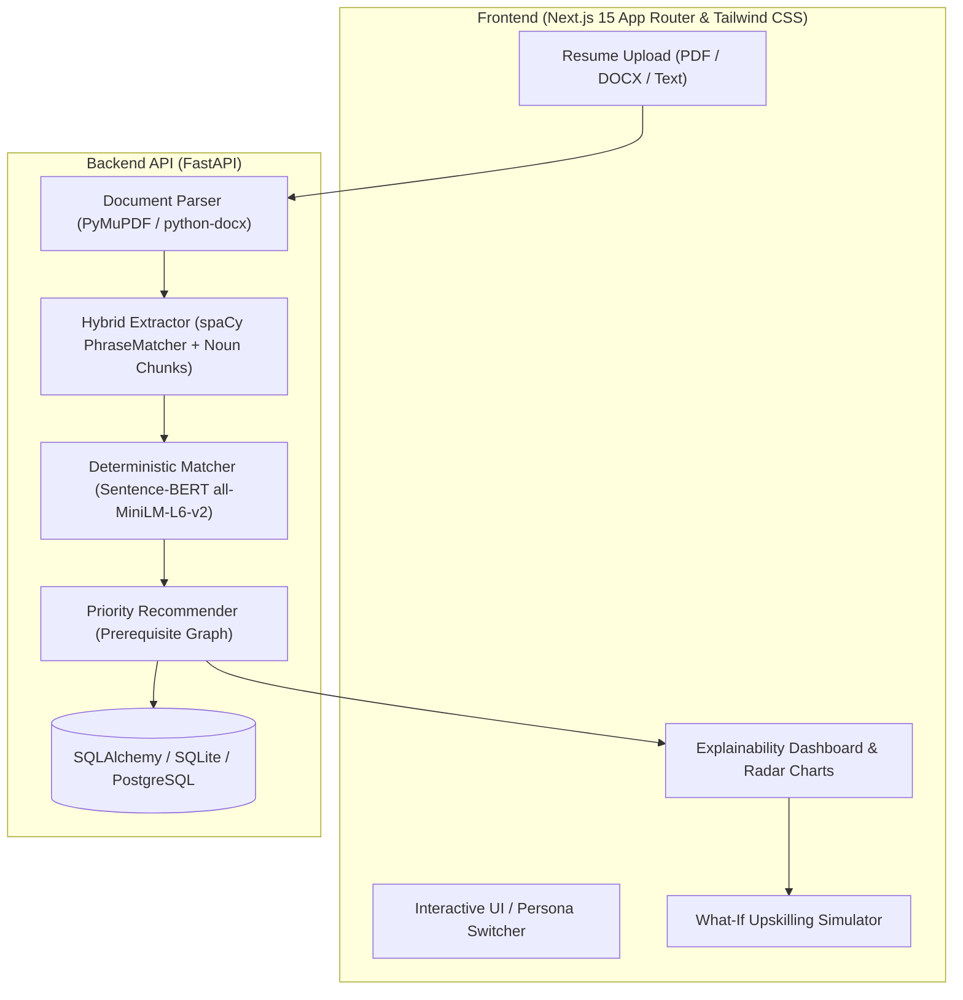

# AI-Based Skill Gap Analyzer
### An Intelligent Career Skill Assessment & Recommendation System

[](https://github.com/SarthakBagasi/Skill-Gap-Analyzer/actions)


An end-to-end full-stack career decision-support prototype designed to extract technical skills from resumes (PDF, DOCX, or raw text) and compare them deterministically against industry role profiles using Natural Language Processing (NLP) and Sentence-BERT semantic similarity.

> **Decision-Support Framing Notice:**  
> This system is strictly an **explainable career decision-support tool** for student self-assessment and learning roadmap generation. It is **NOT** an automated hiring filter, ATS rejection screen, or formal certification engine.

---

## Architecture Overview



### Deterministic Assessment Pipeline

1. **Document Ingestion & Token Preservation (`services/parser.py`)**
   - Ingests multi-page PDFs and Word documents.
   - Preserves symbol-dense programming tokens (`C++`, `C#`, `.NET`, `Node.js`, `CI/CD`).
2. **Hybrid Skill Extraction (`services/extractor.py`)**
   - spaCy `PhraseMatcher` indexed with 60+ canonical skills and aliases.
   - Noun-chunk extractor fallback for emergent candidate entities.
3. **Semantic Matching & Role Skill-Gap Index ($G$) (`services/matcher.py`)**
   - Exact matches achieve immediate canonical verification ($s_j = 1.0$).
   - Semantic proximity is calculated via Sentence-BERT embeddings and cosine similarity.
   - Mathematical formula for Role Skill-Gap Index:
     $$G = 1 - \frac{\sum_{j=1}^{N} w_j \cdot s_j}{\sum_{j=1}^{N} w_j}$$
4. **Prioritized Learning Roadmap (`services/recommender.py`)**
   - Priority score calculation:
     $$p_j = w_j \cdot (1 - s_j) + \text{foundation\_bonus} - \text{readiness\_penalty}$$
   - Foundation-first tie-breaking: prerequisite technologies are scheduled ahead of advanced dependencies.

---

## Empirical Benchmark Evaluation

Running `python evaluate.py` demonstrates the empirical advantage of the Hybrid Matcher over an Exact Keyword Baseline:

| Method | Precision | Recall | F1-Score | Delta F1 |
| :--- | :---: | :---: | :---: | :---: |
| **Exact Keyword Baseline** | **1.000** | 0.350 | 0.516 | Baseline |
| **Hybrid Matcher (Ours)** | 0.879 | **0.906** | **0.886** | **+0.370 (+71.8%)** |

---

## Project Structure

```text
skill-gap-analyzer/
├── .github/
│   └── workflows/
│       └── ci.yml               # GitHub Actions CI workflow
├── backend/
│   ├── app/
│   │   ├── main.py              # FastAPI application & endpoints
│   │   ├── database.py          # SQLAlchemy session & DB connection
│   │   ├── models.py            # Database tables
│   │   ├── schemas.py           # Pydantic schemas
│   │   ├── services/
│   │   │   ├── parser.py        # PDF/DOCX token-safe extraction
│   │   │   ├── extractor.py     # spaCy PhraseMatcher + noun chunks
│   │   │   ├── matcher.py       # S-BERT embeddings & Gap Index
│   │   │   └── recommender.py   # Prioritized roadmap generator
│   │   └── data/
│   │       ├── skills_catalog.json
│   │       ├── role_profiles.json
│   │       └── recommendations.json
│   ├── Dockerfile
│   ├── evaluate.py              # Benchmark evaluation script
│   ├── requirements.txt
│   └── .env.example
├── frontend/
│   ├── src/
│   │   ├── app/
│   │   │   ├── layout.tsx
│   │   │   ├── page.tsx         # Main analysis & simulation workspace
│   │   │   └── history/page.tsx # Audit log & previous runs
│   │   ├── components/
│   │   │   ├── BrandLogo.tsx    # Custom vector nexus logo
│   │   │   ├── InputPanel.tsx   # Upload & candidate personas
│   │   │   ├── GapSummaryCards.tsx # Score gauge & What-If simulator
│   │   │   ├── AnalyticsCharts.tsx # Radar, spectrum & donut charts
│   │   │   ├── EvidenceTable.tsx   # Detailed match explainability
│   │   │   └── LearningRoadmap.tsx # 3-phase checklist roadmap
│   │   └── types/
│   │       └── analysis.ts
│   ├── Dockerfile
│   ├── package.json
│   └── tailwind.config.js
├── docker-compose.yml           # Multi-container orchestration
├── CONTRIBUTING.md              # Contribution guidelines
├── .gitignore
└── README.md
```

---

## Quick Start Guide

### Option 1: Docker Compose (Recommended)

Run both the frontend and backend services in isolated containers:

```bash
# Clone the repository
git clone https://github.com/SarthakBagasi/Skill-Gap-Analyzer.git
cd Skill-Gap-Analyzer

# Build and start services
docker-compose up --build
```

- Frontend: `http://localhost:3000`
- Backend API & Interactive Docs: `http://localhost:8000/docs`

---

### Option 2: Local Development

#### 1. Backend Setup
```bash
cd backend
python -m venv .venv

# Activate virtual environment
# Windows:
.venv\Scripts\activate
# Linux/macOS:
source .venv/bin/activate

# Install dependencies and download spaCy model
pip install -r requirements.txt
python -m spacy download en_core_web_sm

# Start FastAPI server
uvicorn app.main:app --host 0.0.0.0 --port 8000 --reload
```

Run evaluation benchmark:
```bash
python evaluate.py
```

#### 2. Frontend Setup
```bash
cd frontend
npm install
npm run dev
```
Open `http://localhost:3000` in your browser.

---

## API Endpoints Reference

| Method | Endpoint | Description |
| :--- | :--- | :--- |
| `GET` | `/health` | Service health status |
| `GET` | `/roles` | List predefined industry role profiles |
| `POST` | `/analyze` | Run full deterministic skill gap analysis |
| `GET` | `/history` | Fetch saved assessment runs |
| `GET` | `/history/{run_id}` | Fetch a specific analysis run with roadmap |

---

## Educational Decision-Support Principles

This software is developed strictly for educational decision-support purposes:
1. **Explainability Over Black-Box Decisions:** Every skill match exposes exact similarity metrics, matched source snippets, and token provenance.
2. **Deterministic Reproducibility:** Eliminates stochastic LLM drift in scoring by relying on fixed canonical taxonomies and cosine similarity matrices.
3. **Student Upskilling Focus:** Gap indexes map directly to tangible, prioritized learning roadmaps with official documentation links and portfolio deliverables.
